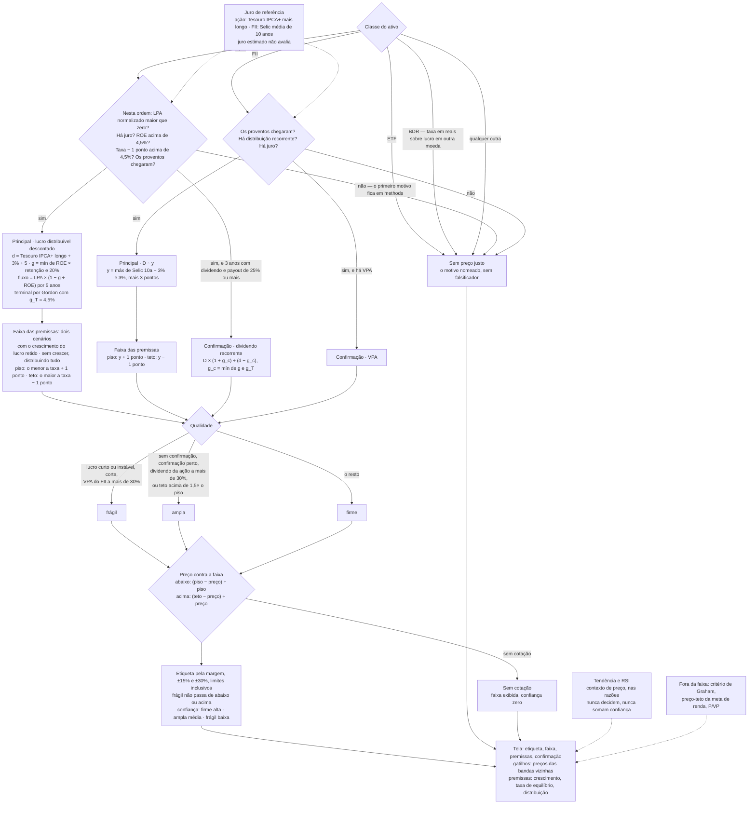

# Score, veredito e falsificadores

Espelho auditado do código, que é a fonte de verdade: fórmula divergente é bug deste documento.

---

## Score de oportunidade

Nota de 0 a 100 por ativo. `analysis/scoring.py`

### Dimensões

| Dimensão | Fórmula | Satura em | Âncora |
|---|---|---|---|
| Margem de segurança | `50 + margem × 100` | ±50% | `_score_mos` |
| Qualidade | média de `ROE × 4` e `margem × 5` | ROE 25%, margem 20% | `_score_quality` |
| Dividendos | `DY × 12,5` | DY 8% | `_score_dividend` |
| Alavancagem | `100 − D/E ÷ 2` | D/E 200% | `_score_leverage` |
| Crescimento | `(crescimento + 10) × 100/30` | −10% a +20% | `_score_growth` |

**RSI e tendência não entram no score** ([ADR-017](../../decisoes/ADR-017-o-score-nao-le-o-tecnico.md)).
O score ordena Descobrir e decide o destaque, e o técnico não decide.

Todas as entradas em **percentual**, exceto a margem de segurança, que é fração.

**O score ordena por posição, não por retorno esperado.** A margem pesa nele, e a medida de
2026-10-12 não mostrou retorno maior abaixo do preço justo (ver *Margem de segurança*).

### Pesos — ações e BDRs, por perfil de risco

| Dimensão | Conservador | Moderado | Arrojado |
|---|---|---|---|
| Margem de segurança | 30% | 30% | 20% |
| Qualidade | 20% | 20% | 20% |
| Dividendos | **25%** | 15% | **5%** |
| Alavancagem | 15% | 10% | 5% |
| Crescimento | **5%** | 15% | **40%** |

`scoring.py::OPPORTUNITY_WEIGHTS`. Os pesos somam 95%, 90% e 90%, e o score divide pelo peso
disponível, então o peso efetivo com todos os dados é o nominal sobre essa soma: no conservador, os
dividendos pesam 26%; no arrojado, o crescimento pesa 44%.

O BDR usa os pesos da ação, mas não tem preço justo: a margem fica de fora, e o score se divide pelo
peso que sobra. ETF não tem score.

### Pesos — FIIs, por perfil de risco

| Dimensão | Conservador | Moderado | Arrojado |
|---|---|---|---|
| Margem de segurança | 40% | 50% | **65%** |
| Dividendos | **60%** | 50% | 35% |

`scoring.py::FII_WEIGHTS`. O conservador pesa a renda; o arrojado, o desconto.

**ETF e BDR não têm score.** Nenhum dos dois tem preço justo (ADR-014), e a fonte não entrega
fundamento deles: sem dimensão aplicável, a completude é zero e a tela mostra "Sem dado". Uma nota
só de dividendo leria como oportunidade a política de distribuição de um fundo.

### Normalização por dado faltante

Dimensão sem dado é removida, e o peso é renormalizado sobre o que sobrou:

```
score = Σ(peso × valor) ÷ Σ(pesos disponíveis)
completude = Σ(pesos disponíveis) ÷ Σ(todos os pesos)
```

### O piso de completude

`MIN_DATA_COMPLETENESS = 0.5`, em `analysis/score_ruler.py`. Abaixo do piso, o score existe mas
**não é apresentado como banda**: o cliente mostra a leitura como insuficiente
(`fiScoreBandFor` devolve a banda `insufficient` em `mobile/lib/core/product_rules.dart`).

O corte acontece **na apresentação, não no cálculo**, e isso é deliberado: suprimir entregaria tela
vazia em vez de leitura parcial declarada.

**Cobertura dos fundamentos — medição histórica sobre a BRAPI**, em 2026-09-25, 31 ativos. A BRAPI
saiu em 2026-10-12, e a cobertura com a base própria **não foi remedida**. Presentes / total:

| Classe | n | ROE | Margem | Cresc. | D/E | VPA | LPA | Val. mercado | DY | 3 exercícios de lucro |
|---|---|---|---|---|---|---|---|---|---|---|
| Ação | 17 | 17 | 17 | 17 | 17 | 17 | 17 | 15 | 16 | 17 |
| Banco | 4 | 4 | 4 | 4 | 0 | 4 | 4 | 3 | 4 | 4 |
| FII | 6 | 0 | 0 | 0 | 0 | 6 | 0 | 0 | 6 | 0 |
| BDR | 2 | 0 | 0 | 0 | 0 | 0 | 2 | 2 | 0 | 0 |
| ETF | 2 | 0 | 0 | 0 | 0 | 0 | 0 | 0 | 0 | 0 |

Naquela medição, a cobertura de ação era completa, e o piso quase nunca disparava. Banco não tem D/E,
por decisão. Em FII, BDR e ETF, o que faltava era o que não se aplica à classe, e não falha de coleta.
Repetir a medição:
`GET /api/v1/data-quality` (exige sessão).

`tests/test_regua_nas_duas_plataformas.py` confronta o limiar do Python com o do Dart. **O Python é
a fonte.**

### Bandas

| Score | Banda |
|---|---|
| ≥ 75 | Forte |
| ≥ 60 | Boa |
| ≥ 40 | Neutra |
| < 40 | Fraca |
| completude abaixo de 50% | Sem dado |

Os **limiares** moram em `analysis/score_ruler.py` — **a fonte é o Python**, e o espelho em
`mobile/lib/core/score_ruler.dart` muda depois, nunca antes. Os **rótulos** existem só no aplicativo
(`fiScoreBands`, em `mobile/lib/core/product_rules.dart`).

---

## Veredito

Sai da margem de segurança, e só dela. A qualidade da faixa limita a intensidade. `analysis/decision.py`

### A leitura pela margem

| Margem | Código | Etiqueta |
|---|---|---|
| ≥ +30% | `STRONG_BUY` | Bem abaixo do preço justo |
| ≥ +15% | `BUY` | Abaixo do preço justo |
| entre −15% e +15% | `HOLD` | No preço justo |
| ≤ −15% | `SELL` | Acima do preço justo |
| ≤ −30% | `STRONG_SELL` | Bem acima do preço justo |
| sem faixa | `UNKNOWN` | Sem preço justo |

**A medida de margem na tela não reclassifica.** A nota dela ("Algum desconto", "Perto do justo")
sai do veredito que o servidor deu (`fiMarginBandForVerdict`); os limiares ficam espelhados em
`product_rules.dart` (`kMarginBuy`, `kMarginStrongBuy`) e `test_regua_nas_duas_plataformas.py`
compara com os daqui.

**A etiqueta descreve posição, não ordem.** Os códigos ficam, porque carteira, alertas e estratégia os leem.

**Com qualidade `fragil`, a leitura não passa de "abaixo" ou "acima"**: `STRONG_BUY` vira `BUY` e
`STRONG_SELL` vira `SELL` (`decision.py::verdict_for`). A margem crua fica em `band_verdict`, e a razão
diz que a etiqueta foi contida.

### O caminho inteiro, do tipo do ativo à etiqueta



### A análise técnica não decide

Tendência e RSI **não alteram a leitura**, nem com faixa nem sem ela. Sem faixa, a etiqueta é "Sem
preço justo", e `basis` é `none`. Aparecem nas razões como
contexto de preço, e não somam confiança: os dois saem do mesmo preço. Ver
[ADR-013](../../decisoes/ADR-013-o-tecnico-nao-decide.md) e [ADR-014](../../decisoes/ADR-014-um-modelo-por-classe.md).

O RSI é o de Wilder, 14 períodos, que é o das plataformas de gráfico: a média simples dos 14 últimos
movimentos esquecia a queda de antes da janela.

### Confiança

| `band_quality` | Confiança | Palavra |
|---|---|---|
| `firme` | 0,70 | alta |
| `ampla` | 0,45 | média |
| `fragil` | 0,30 | baixa |
| sem faixa | 0 | — |
| faixa sem cotação | 0 | — |

Tudo que pesa na evidência — anos de lucro, estabilidade, corte, confirmação, largura — entra pela
qualidade. A interface mostra **a palavra**, não o decimal.

Com faixa e sem cotação, a etiqueta é **"Sem cotação"**, e não "Sem preço justo": o preço justo
existe, e o que falta é o preço para comparar. O veredito é `UNKNOWN` e a confiança é zero
(`decision.py::decide`).

**Consequência que precisa estar escrita:** a leitura herda integralmente a fragilidade do preço
justo. Toda limitação da seção anterior é também limitação dela.

---

## Falsificadores

O que derrubaria a leitura, em condição conferível. `analysis/falsifiers.py`

Os limiares de margem dão, por álgebra, o preço em que a etiqueta muda — com a mesma borda que a
margem mede:

```
margem ≥ 0  →  preço_alvo = piso × (1 − margem_da_banda)
margem < 0  →  preço_alvo = teto ÷ (1 + margem_da_banda)
```

Produz até dois **gatilhos** de preço — a banda acima e a banda abaixo. Com qualidade `fragil`, as
bandas `STRONG_*` não existem, e o gatilho não promete uma etiqueta que a evidência não alcança.

### Gatilho e premissa não são a mesma coisa

| `kind` | O que é | Exemplos |
|---|---|---|
| `gatilho` | o preço em que a etiqueta muda | as duas bandas vizinhas |
| `premissa` | a condição econômica que sustenta o preço justo | o crescimento não se confirmar; a taxa exigida mudar; a distribuição cair |

**Crescimento (ação):** sai quando o valor sem crescimento fica abaixo do preço e o preço não passa
do teto — diz de quanto a quanto o valor cai. Só existe quando crescer cria valor: se o ROE não paga
a taxa, o crescimento não se confirmar faria o valor subir, e o falsificador não falsificaria nada.

**Taxa (ação):** a taxa em que o valor central iguala o preço de hoje
(`premises.breakeven_discount_rate`, por bisseção). Acima da taxa atual, é o quanto ela pode subir
antes de a folga acabar; abaixo, o quanto teria de cair para o preço de hoje se justificar.

**Distribuição (FII):** o corte que leva o valor central ao preço de hoje — `1 − preço ÷ valor`.

**Sem faixa, a lista sai vazia.** Não há falsificador genérico: "fique de olho nos resultados" seria
almanaque no lugar de uma condição conferível.

---

## Varredura de quedas

`services/dip_service.py` — **a queda é recorte, e não veredito**
([ADR-018](../../decisoes/ADR-018-a-queda-e-recorte-e-nao-veredito.md)).

```
queda = (máxima de 52 semanas − preço) ÷ máxima de 52 semanas     (zero se o preço passou dela)
entra quem cai MIN_DROP_PCT = 15% ou mais                          (ajustável por min_drop)
ordem: margem de segurança, da maior para a menor; sem faixa no fim; empate pela queda
```

Cada item traz a mesma etiqueta, faixa, qualidade e primeira razão da folha do ativo
(`decision.py::decide`).
